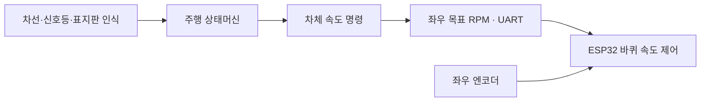

# Smart Road | ROS 2·ESP32 기반 자율주행 로봇

차선·신호등·표지판 인식 결과를 바탕으로 주행·정지·차선 변경을 판단하고, 좌우 바퀴의 속도를 제어하는 소형 자율주행 로봇 팀 프로젝트입니다. 실물 로봇은 Raspberry Pi 4와 ESP32를 UART로 연결했고, Gazebo Harmonic에 별도의 시뮬레이션 환경을 구성했습니다.

**담당 | 김윤정** — 주행 상태머신, ESP32 바퀴 속도 제어, ROS 2–ESP32 연동, Pure Pursuit 경로 추종 실험

## 시연

<!-- 공개 시연 MP4를 GitHub 웹 편집창에서 첨부하고, 생성된 URL을 이 위치의 빈 줄에 넣으세요. -->
**<장애물 회피 및 차선 변경>**

**<정지 표지판 확인 후 잠시 정지, 빨간 정지선에서 잠깐 정차>**

[프로젝트 발표 자료](docs/autonomous_driving_v7.pptx)

## 본인 기여

| 담당 | 구현 내용 | 관련 코드 |
| --- | --- | --- |
| 주행 상태머신(FSM) | 차선 및 신호등·표지판 인식 결과를 받아 주행, 정지, 차선 변경을 결정하도록 상태 전이를 구성했습니다. 모노 카메라 기반의 거리 측정으로 물체와의 일정 거리 내에서 상태머신을 적용하였습니다. | [FSM](src/control/control/fsm_node.py) · [속도 명령 발행](src/control/control/control_node.py) |
| ROS 2–ESP32 연동 | 차체의 선속도·각속도 명령을 차동구동 기구학으로 좌우 목표 RPM으로 변환하고, UART로 JSON 명령을 전달하는 팀 인터페이스와 주행 제어를 연동했습니다. | [UART 브리지](src/serial_bridge/serial_bridge/bridge_node.py) |
| 바퀴 속도 제어 | 엔코더로 측정한 좌우 RPM을 이용해 각 바퀴에 PI 제어와 피드포워드를 적용했습니다. PWM과 적분항에 상한을 두고, 새 구동 명령이 끊기면 모터를 정지시키는 타임아웃을 적용했습니다. | [ESP32 펌웨어](esp32_firmware/src/main.cpp) |
| 경로 추종 실험 | 웨이포인트를 따라가는 Pure Pursuit 노드를 구현하고, LiDAR 기반 지도·위치 추정 구성과 연동했습니다. | [경로 추종 노드](src/track_overlay/track_overlay/path_follower.py) · [위치 추정 구성](src/localization/) |

## 주행 제어 흐름

팀 시스템은 Raspberry Pi 4에서 카메라 인식과 ROS 2 주행 판단을 실행합니다. ESP32는 목표 RPM을 받아 엔코더 피드백으로 PWM을 보정합니다. 펌웨어에는 목표·측정 RPM과 PWM을 기록할 수 있는 텔레메트리가 포함돼 있습니다.

## 실행 자료

| 환경 | 관련 파일 |
| --- | --- |
| 실물 로봇 | [Raspberry Pi 실행 스크립트](scripts/run_pi4.sh) · [ESP32 빌드 가이드](esp32_firmware/README.md) |
| Gazebo Harmonic | [Gazebo 실행 파일](src/robot_simul/launch/gazebo.launch.py) |
| 개발 환경·인터페이스 | [팀 Docker 설정 가이드](https://github.com/jsdbswjd/smart-road-autonomous-robot/blob/b0b61f2fb68943d700a20f65d8d8f282bfd285ae/README.md) · [ROS 2 토픽 명세](TOPIC_SPEC.md) |

## 팀 프로젝트와 원본 저장소

이 저장소는 [팀 원본 저장소](https://github.com/whizz7ng/smart-road-autonomous-robot)의 개인 포크입니다. 위 표에 개인 담당 범위와 관련 코드를 표시했습니다.
